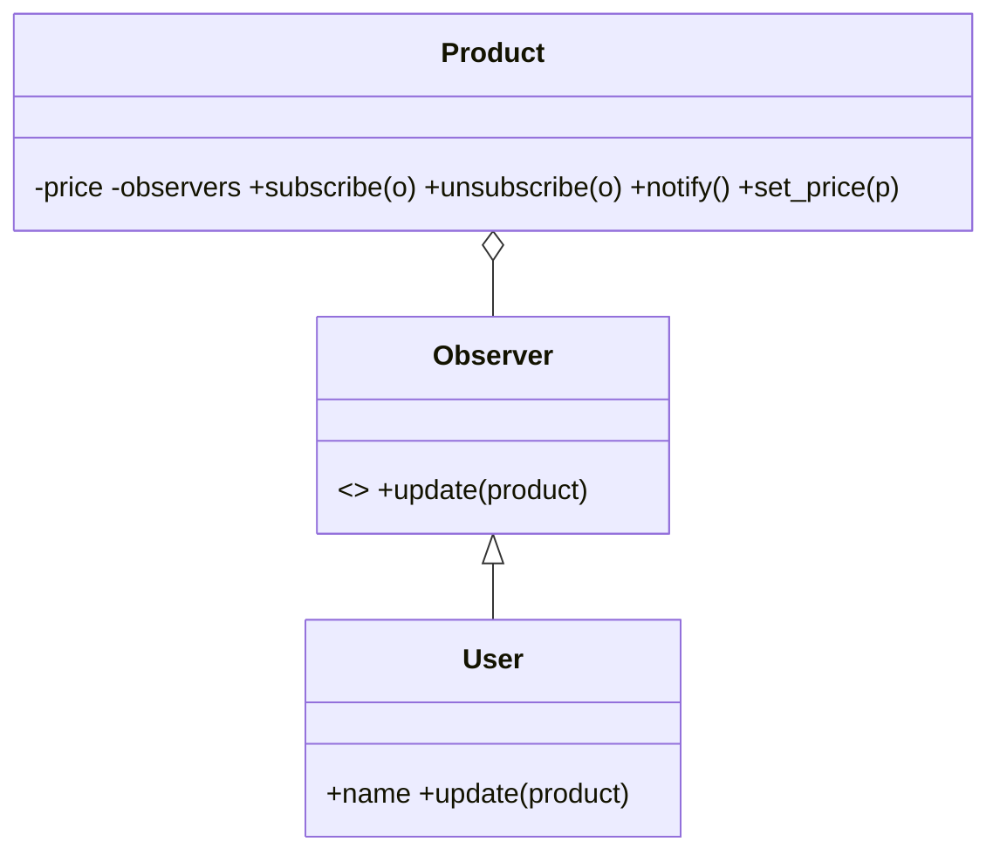
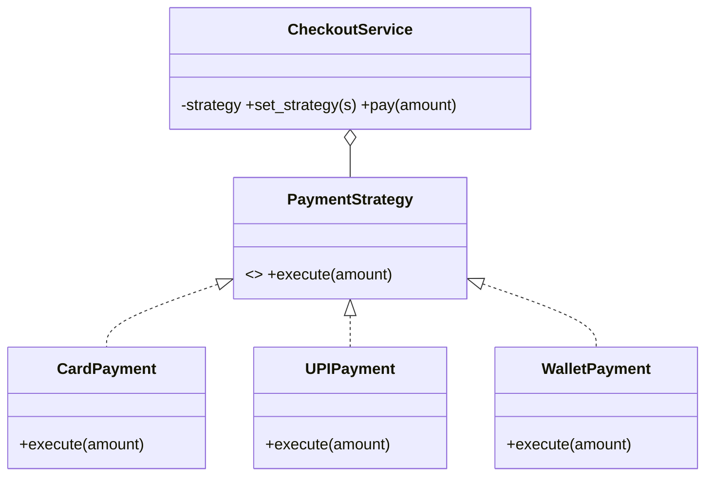
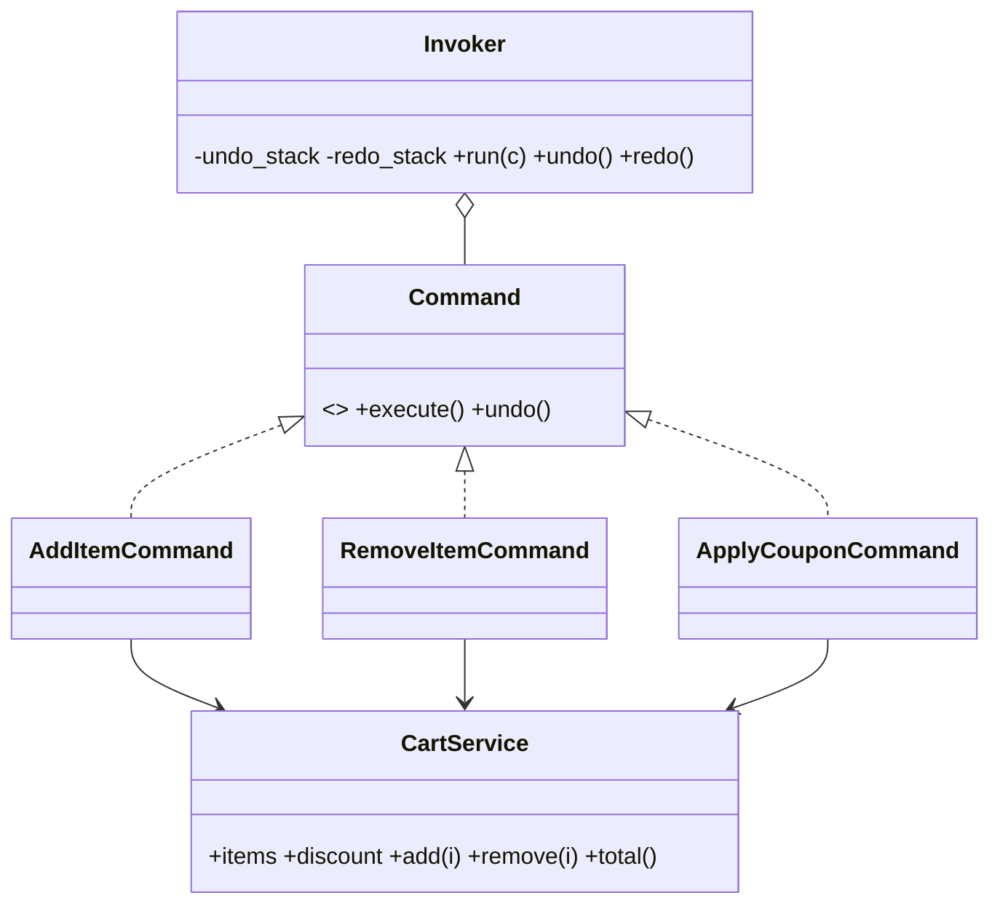

# E-Commerce Website: Behavioral Design Patterns

**Course:** Software Engineering and System Design (24CS301PC311)
**Assignment:** 7: Implementing Design Patterns II (Behavioral)
**Language:** Python 3 (OOP)

## Overview
A small online shopping system (Amazon-style) that uses three behavioral design patterns:

| Feature | Pattern | OO Concepts |
|---|---|---|
| Price-drop notifications | Observer | Encapsulation, Polymorphism |
| Payment method at checkout | Strategy | Abstraction, Composition, Polymorphism |
| Cart actions with undo/redo | Command | Encapsulation, Decoupling |

## Project Structure
```
ecommerce-behavioral-patterns/
├── observer.py    # Observer pattern
├── strategy.py    # Strategy pattern
├── command.py     # Command pattern
├── main.py        # Demo using all three
└── README.md
```

## How to Run
```bash
python main.py
```

## 1. Observer Pattern: Price Drop Notification
**Problem:** Users who subscribe to a product must be notified automatically when its price drops.

- **Subject:** `Product`, with `subscribe()`, `unsubscribe()`, `notify()` and `set_price()`
- **Observer (abstract):** `Observer`, with `update()`
- **Concrete Observer:** `User`

`set_price()` calls `notify()` only when the price decreases. `notify()` calls `update()` on every subscriber.

**OO concepts:** *Encapsulation* (price and observer list are private to `Product`); *Polymorphism* (all observers are handled through the `update()` interface).



## 2. Strategy Pattern: Payment Selection
**Problem:** Checkout must support multiple payment methods, chosen at runtime, without changing checkout code.

- **Strategy (interface):** `PaymentStrategy`, with `execute(amount)`
- **Concrete strategies:** `CardPayment`, `UPIPayment`, `WalletPayment`
- **Context:** `CheckoutService`, with `set_strategy()` and `pay()`

**OO concepts:** *Abstraction* (interface); *Composition* (`CheckoutService` holds a strategy); *Polymorphism* (each strategy implements `execute()` differently).



## 3. Command Pattern: Cart Actions with Undo/Redo
**Problem:** Cart actions must be reversible, and the UI should not depend on how the cart works.

- **Command (interface):** `Command`, with `execute()` and `undo()`
- **Concrete commands:** `AddItemCommand`, `RemoveItemCommand`, `ApplyCouponCommand`
- **Receiver:** `CartService`
- **Invoker:** `Invoker` (acts as the UI button), keeping undo and redo stacks

**OO concepts:** *Encapsulation* (each request is an object with its own state); *Decoupling* (the invoker knows nothing about the cart).



## Sample Output
```
=== Observer: Price Drop Notification ===
Asha: Phone now ₹18000!
Ravi: Phone now ₹18000!
Asha: Phone now ₹17000!

=== Command: Cart with Undo/Redo ===
Total after coupon: 15750.0
After undo coupon: 17500
After redo coupon: 15750.0
After removing case: 15300.0

=== Strategy: Payment ===
Paid ₹15300.0 via UPI
Paid ₹15300.0 by Card
Paid ₹15300.0 from Wallet
```

## Git Workflow
- `feature/observer`, `feature/strategy`, `feature/command`: one branch per pattern
- Each branch was merged into `main`

## Learning Outcomes
- Applied Observer, Strategy, and Command patterns to a real e-commerce scenario
- Used encapsulation, abstraction, inheritance, and polymorphism in practice
- Practiced Git branching and merging with GitHub
- Designed modular, flexible, and scalable code

## Author
Suchith Kumar, B.Tech CSE, SR University